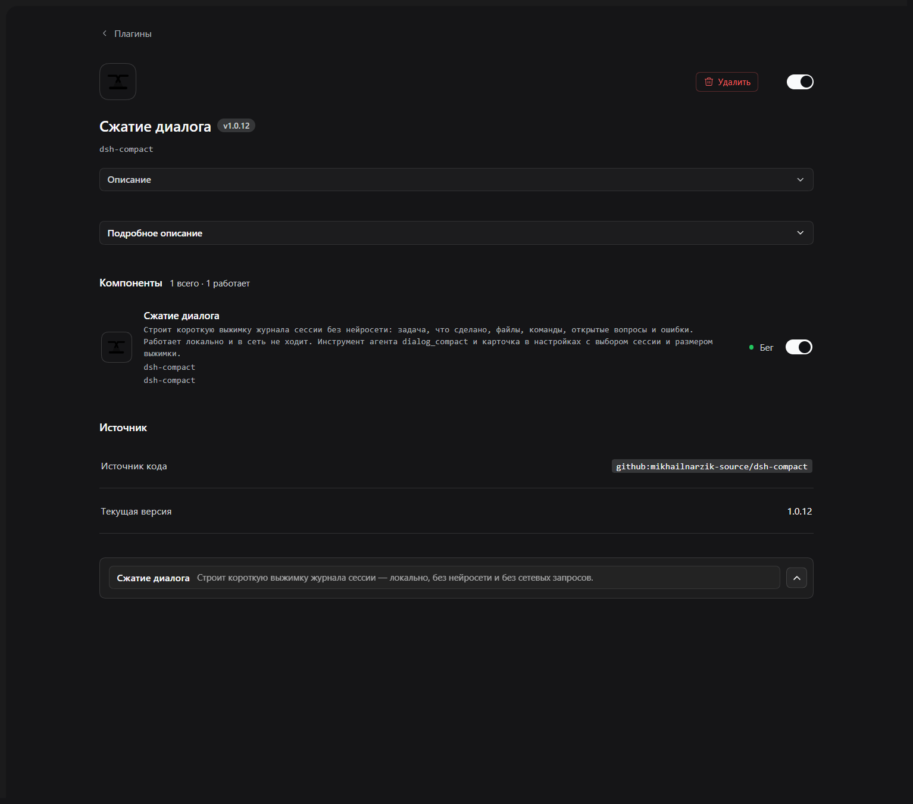

# dsh-compact

Сжатие длинного диалога DeepSeek Harness **без нейросети**: локально,
бесплатно, без сетевых запросов. Плагин читает журнал сессии (файл, куда DSH
записывает ход беседы) и собирает короткую Markdown-выжимку: важные сообщения
остаются (обрезанные), служебное и повторяющееся выбрасывается.



*Страница плагина в интерфейсе DSH.*

## Что это и зачем

Долгий диалог занимает много места: в нём теряется суть, а пересказывать его
моделью — долго и платно. Плагин делает **экстрактивную выжимку**: не
пересказывает текст своими словами, а отбирает из журнала самое полезное и
обрезает лишнее. В результате получается короткий Markdown с разделами:

- **Задача** — что вы просили;
- **Что сделано** — решения и выводы ассистента;
- **Файлы** — какие файлы и пути упоминались;
- **Команды** — какие инструменты вызывались;
- **Открытые вопросы** — что осталось сделать;
- **Ошибки** — что падало.

Термины простыми словами:

- **журнал сессии** — файл, в который DSH построчно пишет ход диалога
  (`session.v4.jsonl.zstd` в `~/.dsh/sessions/...`);
- **zstd** — способ сжатия файлов; журнал сжат, плагин распаковывает его
  встроенными средствами Node.js;
- **экстрактивная выжимка** — «нарезка» из существующих фраз, без генерации
  нового текста;
- **бюджет** — сколько символов разрешено выжимке (жёсткий предел).

Зачем это нужно: быстро получить конспект длинной сессии, передать его в новую
сессию или сохранить в файл — без токенов и без отправки данных в сеть.

## Как открыть

1. Нажмите **Настройки** (шестерёнка).
2. Перейдите в **«Плагины»**.
3. Найдите карточку **«Сжатие диалога»** (иконка: две сходящиеся стрелки) и
   откройте её.
4. Страница открыта сразу: шапка с иконкой 🗜️, названием «Сжатие диалога»,
   подсказкой, статус-чипом и кнопками «Обновить» / «Свернуть», ниже карточки
   «Параметры» и «Предпросмотр выжимки». Шеврон в шапке сворачивает страницу до
   одной строки, повторное нажатие разворачивает.

## Как пользоваться пошагово

Сценарий: сделать конспект длинной сессии.

1. Откройте панель, как описано выше.
   **Что происходит:** панель читает список сессий; пока это идёт, написано
   «Загружаю список сессий…».
2. В поле **«Сессия»** выберите нужный диалог. По умолчанию выбран самый
   свежий; у каждой строки — название, дата и короткий номер `#abcd1234`.
   Ниже показан путь к журналу выбранной сессии.
3. Оставьте **«Размер выжимки (символы)»** 6000 или введите свой (от 300 до
   200 000).
4. При необходимости поставьте галочку **«Сохранить в файл»**.
5. Нажмите **«Сжать»**.
   **Что вы увидите:** кнопка на пару секунд станет «Сжимаю…», затем ниже
   появятся счётчики «было 152 400 символов → стало 5 980 символов», зелёная
   плашка «−96%» и сам текст выжимки в моноширинном блоке.
6. Нажмите **«Скопировать»** — выжимка уйдёт в буфер обмена (появится
   «Выжимка скопирована в буфер обмена»). Если была включена галочка
   сохранения, появится «Сохранено: `<путь>`».

Изменение сессии сбрасывает старый результат — это нормально: после выбора
другого диалога нажмите «Сжать» ещё раз.

## Примеры

Команды агенту в чате (агент сам вызовет инструмент `dialog_compact`):

- «Сожми этот диалог в 4000 символов» — выжимка текущей сессии.
- «Сделай выжимку прошлой сессии и сохрани в файл» — с `save: true`.
- «Уложи итоги работы в 1500 символов» — короткий бюджет.
- «Что мы сделали в этой сессии? Сожми и перечисли открытые вопросы» — выжимка
  с разделами «Что сделано» и «Открытые вопросы».

Вызов инструмента напрямую (для понимания параметров):

```
dialog_compact({ sessionId?, budget?, save? })
  → { ok, sessionId, title, markdown, before, after, savedPath? }
```

| Параметр | Смысл | Значения |
| --- | --- | --- |
| `sessionId` | какой диалог сжимать | без него берётся последняя сессия проекта |
| `budget` | размер выжимки в символах | 300…200 000, по умолчанию 6000 |
| `save` | записать результат в файл | `true` / `false`, по умолчанию `false` |

`before` — длина журнала в символах, `after` — длина готовой выжимки.

Сценарии в панели:

| Задача | Настройки |
| --- | --- |
| Короткий конспект для новой сессии | бюджет 2000–3000 |
| Архив итогов работы | «Сохранить в файл» и бюджет 6000 |
| Ужать очень длинную сессию | бюджет 10 000 и больше |
| Перечитать чужую сессию (субагента) | выбрать строку с пометкой «(subagent)» |

## Что вы увидите

- **Шапка страницы:** иконка 🗜️, название «Сжатие диалога», подсказка,
  статус-чип («Готово», «Загрузка…», «Выжимка готова», «Ошибка») и кнопки
  «Обновить» / «Свернуть»; «Обновить» перечитывает список сессий.
- **Карточки-секции:** «Параметры» (сессия, размер выжимки, «Сохранить в файл»)
  и «Предпросмотр выжимки» (кнопки «Сжать» / «Скопировать» и Markdown).
  Контент по центру шириной до 960 px; уже 760 px — одна колонка.
- **«Сессия»:** выпадающий список последних 25 сессий; строки вида
  «Название · дата · #abcd1234», у сессий помощников — пометка «(subagent)».
  Ниже — строка «Журнал: `<путь>`».
- **«Размер выжимки (символы)»:** поле числа и подсказка «От 300 до 200000. По
  умолчанию 6000».
- **«Сохранить в файл»:** галочка.
- **Кнопки:** «Сжать» (пока идёт работа — «Сжимаю…»); после результата рядом
  появляется «Скопировать».
- **Сообщения:** красная рамка с ошибкой или серая — с результатом
  («Выжимка скопирована в буфер обмена», «Сохранено: `<путь>`»).
- **Счётчики:** «было N символов → стало M символов» и зелёная плашка
  «−K%».
- **«Предпросмотр выжимки»:** моноширинный блок с Markdown. Начинается с
  заголовка «# Выжимка диалога», строки с id сессии, датой (UTC), числом
  событий и темой, дальше разделы `## Задача`, `## Что сделано` и так далее.
  Пока ничего не сжато — «Выберите сессию и нажмите «Сжать»».

## Частые ошибки и что делать

| Симптом | Причина | Что делать |
| --- | --- | --- |
| «В ~/.dsh/sessions пока нет сессий» | DSH ещё не записал ни одной сессии или используется другой `DSH_HOME` | открыть хотя бы один диалог; проверить, что каталог сессий тот же, что у DSH |
| «В этой сборке Node нет поддержки zstd» | Node.js старше 22.15 или собран без zstd | обновить Node.js/DeepSeek Harness до версии с поддержкой zstd |
| «Host-часть плагина не загрузилась» (404) | host-часть плагина не поднялась | полностью закрыть Harness (включая иконку в трее → «Выход») и запустить снова; перезагрузки страницы мало |
| «Не удалось загрузить список сессий» | host-часть ответила ошибкой | перезапустить Harness; если повторяется — смотреть логи DSH |
| «Не удалось построить выжимку» | сессия не найдена или журнал повреждён | выбрать другую сессию; проверить, что журнал на месте |
| «Журнал сессии слишком большой» | журнал больше 192 МиБ | сжимать не нужно — это защита; при необходимости возьмите сессию поменьше |
| Разделы выжимки пустые («—») | сессия очень короткая или события ещё не записаны в журнал | сжать более старую/длинную сессию; подождать, пока DSH допишет журнал |
| Кнопка «Сжать» неактивна | список сессий пуст или идёт работа | дождаться загрузки/завершения, выбрать сессию |
| Файл не появился | не включена галочка «Сохранить в файл» или другой `DSH_HOME` | включить галочку; искать в `~/.dsh/dsh-compact/<session-id>.md`, путь показан в сообщении |
| Выжимка «не про то» | метод экстрактивный: он отбирает фразы, а не пересказывает | увеличить бюджет; сжать более короткий участок отдельной сессией |

## Ограничения и безопасность

- **Только локально.** Плагин не делает сетевых запросов, не обращается к
  модели и не тратит токены. Нужны только файлы журналов на диске.
- **Экстрактивный метод.** Выжимка — это отобранные и обрезанные фрагменты
  существующего текста, а не пересказ. Формулировки могут звучать «рвано».
- **Журнал на диске.** События, которые ещё не записаны в журнал (самый конец
  текущего хода), в выжимку не попадут.
- **Эвристики.** Ошибки и открытые вопросы ищутся по текстовым признакам,
  поэтому редкая формулировка может не распознаться.
- **Бюджет жёсткий:** длина Markdown не превышает заданный размер; при нехватке
  места хвосты разделов отрезаются в порядке важности, «Задача» сохраняется
  дольше всех.
- **Сохранение** — в `~/.dsh/dsh-compact/<session-id>.md` (или в
  `<DSH_HOME>/dsh-compact/...`, если `DSH_HOME` задан). Имя файла очищается от
  посторонних символов.
- **Данные не уходят наружу** и не попадают в модель: плагин только читает
  журнал и пишет файл.
- Журнал больше 192 МиБ не обрабатывается — это защита от случайно огромного
  файла.

Требования: DSH с Node.js >= 22.15 (нужен встроенный `node:zlib` с zstd),
Windows/macOS/Linux.

## Связанные плагины

- **dsh-notify** — плашки о завершении задач; удобно, когда сжатие запускается
  в фоне.
- **dsh-team** — панель «Команда» для задания нескольким помощникам; выжимка
  помогает передать им контекст.
- **dsh-sync** — синхронизация истории сессий между устройствами.
- **dsh-review** — ревью изменений и создание PR.
- **dsh-polish** — единое оформление кнопок и полей у всех плагинов.

## Установка

Плагин ставится как обычный bundle DSH через менеджер плагинов
(**Настройки → Плагины**) — из репозитория или из локальной папки. Например,
для локальной копии:

```powershell
dsh plugin --profile desktop add "link:<путь к папке dsh-compact>"
```

После установки или обновления host-кода перезапустите DeepSeek Harness.
Проверки для разработки:

```powershell
node --check index.js
node --check client.js
node --test test/
```

Тесты не требуют реальных сессий: журнал-фикстура собирается внутри теста.
Удаление: **Настройки → Плагины** → у карточки «Сжатие диалога» кнопка
удаления, или `dsh plugin --profile desktop remove dsh-compact`.
