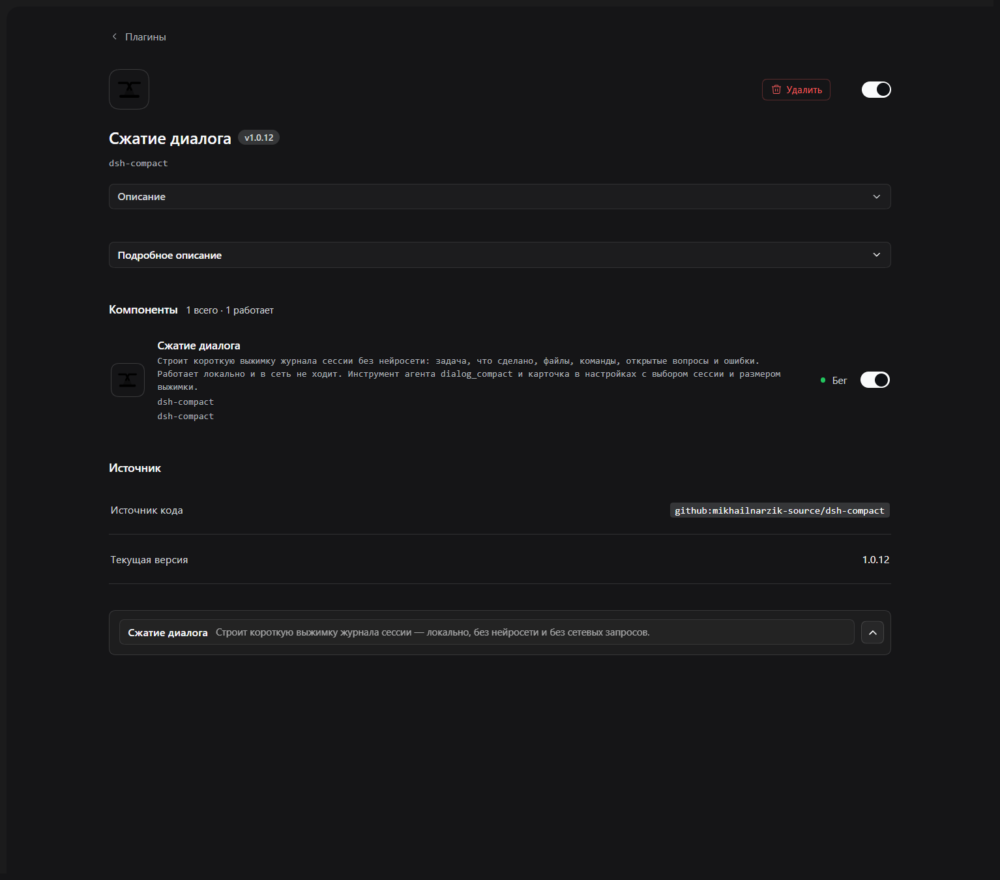
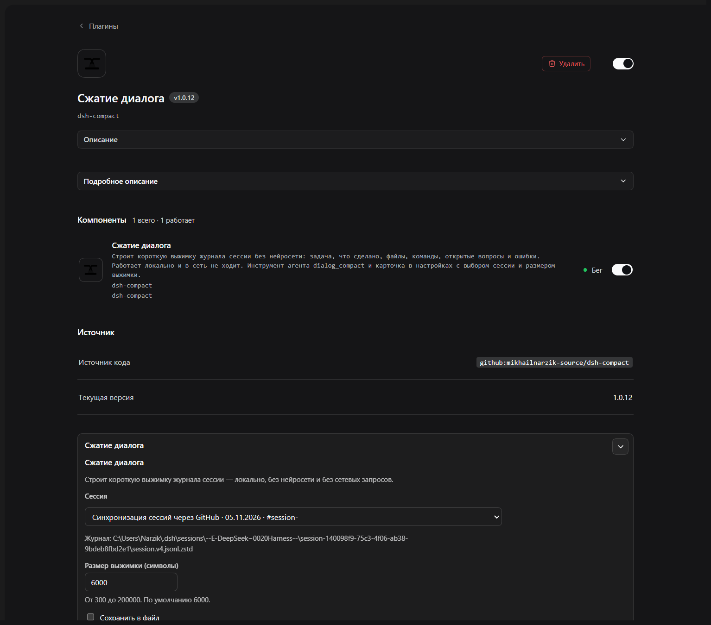

# Сжатие диалога — подробное описание

Плагин `dsh-compact` строит короткую выжимку длинного диалога DeepSeek Harness
**без нейросети**: читает журнал сессии с диска, отбирает важные события
эвристиками и собирает Markdown. Этот файл — подробная версия руководства: те же
шаги, но с разбором каждого элемента, параметров и ограничений. Краткая версия —
в `README.md` плагина.

## Что это и зачем

Длинная сессия — это мегабайты журнала, в которых теряется суть. Модель может
пересказать диалог, но это долго, платно и не всегда нужно: часто достаточно
«выжимки фактов». Плагин делает её локально и мгновенно.

В выжимку попадают шесть разделов:

| Раздел | Содержимое |
| --- | --- |
| Задача | сообщения пользователя, сжатые до 400 символов каждое |
| Что сделано | решения и выводы ассистента: списки, заголовки, слова «итог», «готово», «осталось» |
| Файлы | имена файлов и пути из сообщений и аргументов инструментов |
| Команды | названия инструментов и краткие аргументы; повторы схлопываются в `×N` |
| Открытые вопросы | фразы про «осталось», «нужно», `TODO`, вопросы |
| Ошибки | строки ошибок из выводов инструментов (не больше трёх на вывод) |

Термины:

- **журнал сессии** — файл, куда DSH дописывает события диалога:
  `~/.dsh/sessions/<проект>/<сессия>/session.v4.jsonl.zstd`;
- **zstd** — алгоритм сжатия; журнал — это несколько склеенных zstd-кадров
  (обычный JSONL тоже поддерживается), плагин распаковывает их через
  `node:zlib`;
- **экстрактивная выжимка** — отбор и обрезка существующих фрагментов, а не
  генерация нового текста;
- **бюджет** — жёсткий предел длины готовой выжимки в символах.

Зачем: быстро получить конспект, передать контекст в новую сессию, сохранить
итоги в файл — без токенов и без сети.

## Как открыть

1. **Настройки** (шестерёнка).
2. Раздел **«Плагины»**.
3. Карточка **«Сжатие диалога»** — откройте её. Иконка плагина — две
   сходящиеся стрелки.
4. Страница открыта сразу: шапка с иконкой 🗜️, названием, подсказкой,
   статус-чипом и кнопками «Обновить» / «Свернуть»; ниже карточки «Параметры» и
   «Предпросмотр выжимки». Шеврон в шапке сворачивает страницу до одной строки и
   разворачивает обратно.

**Панель в левом меню.** Плагин регистрирует собственную панель: иконка 🗜️ в
левой панели открывает те же настройки — выбор сессии, размер выжимки и
предпросмотр, — без страницы плагин-менеджера. Если панель откреплена, она
остаётся в меню «Ещё», откуда её можно закрепить обратно: состояние хранит
плагин «Оформление интерфейса».

Второй способ — попросить агента: «сожми этот диалог» или «сделай выжимку
сессии и сохрани в файл». Агент вызовет инструмент `dialog_compact`.

## Как пользоваться пошагово

Сценарий: сохранить итоги длинной сессии в файл.

1. Откройте страницу плагина: **Настройки → Плагины → «Сжатие диалога»**.
   **Что происходит:** панель запрашивает у host-части список сессий; пока идёт
   загрузка — «Загружаю список сессий…».
2. В поле **«Сессия»** выберите нужный диалог. По умолчанию выбран самый
   свежий; под списком показан путь к его журналу.
3. Введите **«Размер выжимки (символы)»** — например 4000. Допустимо от 300 до
   200 000; по умолчанию 6000.
4. Поставьте галочку **«Сохранить в файл»**.
5. Нажмите **«Сжать»**.
   **Результат:** кнопка ненадолго станет «Сжимаю…», затем появятся:
   - счётчики «было 152 400 символов → стало 5 980 символов»;
   - зелёная плашка «−96%» (насколько короче стало);
   - сообщение «Сохранено: `C:\Users\...\.dsh\dsh-compact\<id>.md`»;
   - предпросмотр Markdown в моноширинном блоке.
6. Нажмите **«Скопировать»**, если выжимку нужно вставить в чат.

Если поменять сессию, старый результат сбрасывается — это сделано, чтобы не
перепутать диалоги. После смены бюджета или галочки сохранения нажмите «Сжать»
ещё раз: настройки применятся только при новом запуске.

## Примеры

Команды агенту:

- «Сожми этот диалог в 4000 символов» → `dialog_compact({ budget: 4000 })` для
  текущей сессии проекта.
- «Сделай выжимку прошлой сессии и сохрани в файл» → `dialog_compact({ save:
  true })`.
- «Уложи итоги работы в 1500 символов» → короткий бюджет, только самое важное.
- «Что осталось сделать? Сожми сессию и перечисли открытые вопросы» →
  выжимка с разделом «Открытые вопросы».

Прямой вызов инструмента:

```
dialog_compact({ sessionId?, budget?, save? })
  → { ok, sessionId, title, markdown, before, after, savedPath? }
```

| Параметр | Тип | Смысл |
| --- | --- | --- |
| `sessionId` | string | id сессии; без него — последняя сессия проекта, из которого вызван инструмент |
| `budget` | number | размер выжимки в символах, 300…200 000, по умолчанию 6000 |
| `save` | boolean | `true` — записать Markdown в `~/.dsh/dsh-compact/<session-id>.md` |

`before` — длина распакованного журнала в символах, `after` — длина готовой
выжимки.

Сценарии:

| Задача | Настройки |
| --- | --- |
| Конспект для новой сессии | бюджет 2000–3000 |
| Архив итогов | «Сохранить в файл», бюджет 6000 |
| Очень длинная сессия | бюджет 10 000–20 000 |
| Выжимка сессии субагента | выбрать строку с пометкой «(subagent)» |

## Что вы увидите

- **Шапка страницы:** иконка 🗜️, название «Сжатие диалога», подсказка,
  статус-чип («Готово», «Загрузка…», «Выжимка готова», «Ошибка») и кнопки
  «Обновить» / «Свернуть». «Обновить» перечитывает список сессий.
- **Секции:** «Параметры» (сессия, размер выжимки, галочка «Сохранить в файл»)
  и «Предпросмотр выжимки» (кнопки «Сжать» / «Скопировать» и сам Markdown).
- **«Сессия»:** выпадающий список последних 25 сессий (название · дата ·
  `#abcd1234`), у сессий субагентов — «(subagent)». Под списком —
  «Журнал: `<путь>`».
- **«Размер выжимки (символы)»:** числовое поле и подсказка «От 300 до 200000.
  По умолчанию 6000».
- **«Сохранить в файл»:** галочка.
- **Кнопки:** «Сжать» (в процессе — «Сжимаю…», кнопка неактивна); после
  результата рядом появляется «Скопировать».
- **Красная рамка** — ошибка; **серая** — сообщение об успехе (копирование или
  сохранение).
- **Счётчики:** «было N символов → стало M символов» и зелёная плашка «−K%».
- **«Предпросмотр выжимки»:** моноширинный блок. Структура Markdown:
  заголовок «# Выжимка диалога», строка метаданных (id сессии, дата UTC, число
  событий, размер журнала, тема), затем разделы `## Задача`, `## Что сделано`,
  `## Файлы`, `## Команды`, `## Открытые вопросы`, `## Ошибки`. Пустой раздел
  показывается строкой «—». Пока ничего не сжато — «Выберите сессию и нажмите
  «Сжать»».


## Как это выглядит



*Рисунок 1. Страница плагина: описание, настройки и кнопки.*



*Рисунок 2. Рабочий раздел плагина: органы управления и результат.*

Страница оформлена в едином стиле: контент по центру шириной до 960 px, шапка с
квадратной иконкой 52×52, статус-чипом и кнопками, карточки-секции со
скруглением 14 px и акцентной полоской у заголовка. Кнопки — единая система:
36 px (в шапке 32), радиус 10, `padding: 0 14px`, шрифт 600 12.5, ширина по
тексту. Primary — мягкая заливка brand 18%, рамка brand 55%, текст brand;
secondary — прозрачный фон с рамкой `border-l4`; danger — мягкая красная
заливка. Белый фон с белым текстом запрещён: в тёмной теме brand белый, поэтому
старые кнопки `button-primary-fill` не читались. Сетка полей `auto-fit`
перестраивается на 1280/1024/768/480 px: на 900 px — одна колонка, на 640 px —
компактные поля; длинные строки переносятся. Цвета берутся только из токенов
темы DSH, поэтому светлая и тёмная темы выглядят одинаково аккуратно.

## Частые ошибки и что делать

| Симптом | Причина | Что делать |
| --- | --- | --- |
| «В ~/.dsh/sessions пока нет сессий» | у DSH нет журналов или задан другой `DSH_HOME` | открыть/создать диалог; проверить `DSH_HOME` и каталог `~/.dsh/sessions` |
| «В этой сборке Node нет поддержки zstd» | Node.js < 22.15 или сборка без zstd | обновить Node.js и/или DeepSeek Harness |
| «Host-часть плагина не загрузилась» (ошибка 404) | host-часть не поднялась | полностью закрыть Harness (трей → «Выход») и запустить снова; перезагрузки страницы недостаточно |
| «Не удалось загрузить список сессий» | ошибка host-части, недоступен `sessionPersistence` | перезапустить Harness; проверить логи DSH |
| «Не удалось построить выжимку» | сессия не найдена, журнал повреждён или слишком большой | выбрать другую сессию; проверить журнал |
| Кнопка «Сжать» неактивна | идёт работа или список сессий пуст | дождаться окончания или выбрать сессию, когда список загрузится |
| Разделы выжимки пустые | сессия слишком короткая или свежие события ещё не в журнале | сжать сессию подлиннее или подождать записи журнала |
| Файл не найден | галочка не была включена или другой `DSH_HOME` | искать по пути из сообщения «Сохранено: …» или в `~/.dsh/dsh-compact` |
| Выжимка обрезана на середине | бюджет жёсткий | увеличить `budget` |

## Ограничения и безопасность

- **Локальность.** Ни одного сетевого запроса, ни обращения к модели, ни
  токенов. Плагин читает только журналы сессий и пишет только файл выжимки.
- **Экстрактивный метод.** Это отбор и обрезка существующих фрагментов;
  пересказа «своими словами» не будет.
- **Журнал на диске.** События, ещё не записанные в журнал, не попадают в
  выжимку. Ошибки и вопросы ищутся по текстовым признакам, поэтому редкая
  формулировка может не распознаться.
- **Бюджет жёсткий.** Длина Markdown не превышает бюджет: при нехватке места
  хвосты разделов отрезаются в порядке важности, «Задача» сохраняется дольше
  всех; в крайнем случае строка обрезается с «…».
- **Защита от гигантских файлов.** Журнал больше 192 МиБ не обрабатывается.
- **Сохранение** — в `<DSH_HOME>/dsh-compact/<session-id>.md` (по умолчанию
  `~/.dsh/dsh-compact/...`); имя файла очищается от недопустимых символов.
- **Приватность.** Выжимка может содержать куски текста и пути; файл хранится
  локально, в модель и в сеть не отправляется.
- **Контекст сессии не меняется.** Плагин только показывает и сохраняет
  выжимку: историю диалога он не сжимает и в модель ничего не подставляет.

Требования: DSH с Node.js >= 22.15 (`node:zlib` с zstd), Windows/macOS/Linux.

## Связанные плагины

- **dsh-notify** — плашки о завершении задач.
- **dsh-team** — панель «Команда» для задания нескольким помощникам; выжимку
  удобно передать им как контекст.
- **dsh-sync** — синхронизация истории сессий между устройствами.
- **dsh-review** — ревью изменений и PR.
- **dsh-polish** — единое оформление кнопок и полей у всех плагинов.

## Как это устроено

| Файл | Что делает |
| --- | --- |
| `index.js` | host-часть: список сессий, чтение журнала, маршруты, инструмент `dialog_compact` |
| `client.js` | браузерная половина: карточка в списке плагинов, предпросмотр, счётчики |
| `lib/compact.mjs` | чистая логика: zstd/JSONL, эвристики, Markdown, бюджет |
| `locale/ru.json`, `locale/en.json` | название и описание плагина в списке «Плагины» |
| `cordis.patch.yml` | вставка плагина в профиль |
| `test/` | тесты `node --test` на фикстуре-журнале |

Маршруты host-части:

- `POST /api/dsh-compact/state` — доступность: сколько сессий, последняя сессия,
  пути к журналам, настройки (`budget`, `minBudget`, `maxBudget`, наличие zstd);
- `POST /api/dsh-compact/preview` — построить выжимку, тело
  `{ sessionId?, budget?, save? }`.

Порядок работы: журнал распаковывается по zstd-кадрам → из событий берутся
реплики пользователя (`source.kind === 'user'`), текстовые блоки ассистента (без
reasoning), вызовы и результаты инструментов → эвристики отбирают решения, пути,
команды, вопросы и ошибки, убирают повторы и почти одинаковые сообщения,
обрезают длинные выводы до трёх строк → Markdown собирается и укладывается в
бюджет. Путь к журналу плагин получает от сервиса `sessionPersistence`, а не
угадывает.

Проверка:

```powershell
node --check index.js
node --check client.js
node --test test/
```
